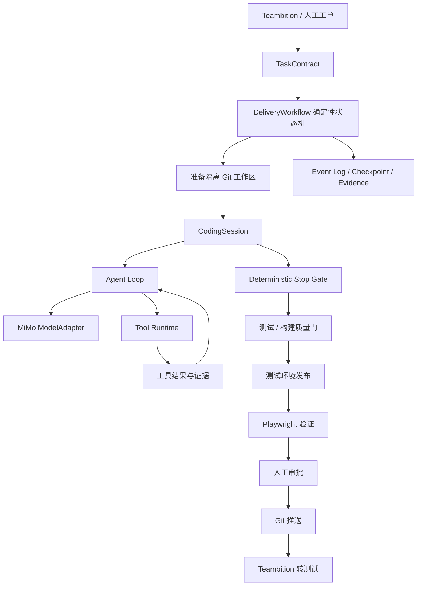

# AI Coding Agent 架构方案

## 1. 目标与边界

系统从 Teambition 获取前端 Bug 或需求，在受控 Git 工作区内完成定位、修改和验证；候选版本只允许自动发布到测试环境，生产发布始终经过独立人工审批。

本方案吸收 Claude Code 的 Agent Loop、工具注册、权限 Hook、上下文压缩和追加式会话日志等模式，但不会复制其产品表层。参考实现包括：

- [learn-claude-code](https://github.com/shareAI-lab/learn-claude-code)
- [deep-dive-claude-code](https://github.com/sawzhang/deep-dive-claude-code)
- [Claude-Code 源码还原研究仓库](https://github.com/pengchengneo/Claude-Code)

最后一个仓库是从公开 npm 包 source map 还原的非官方研究版本，只用于理解设计，不作为依赖或权威接口。

## 2. 核心设计：双层循环



### 2.1 内层：Agent Loop

模型负责解决路径未知的问题：理解工单、搜索代码、提出修改、执行工具、观察失败并继续修复。循环结构保持简单：

1. 构造任务相关上下文；
2. 调用模型；
3. 校验并执行工具；
4. 把结构化工具结果写回消息；
5. 模型停止调用工具时进入 Stop Gate；
6. 证据不足则返回同一循环，满足合同或达到预算才退出。

### 2.2 外层：Delivery Workflow

固定业务流程不交给模型决定。状态机负责工单快照、工作区、构建、测试发布、浏览器验证、审批、推送、工单流转、失败和恢复。每次外部副作用都有幂等键、超时、事件和 Checkpoint。

### 2.3 完成定义

“模型不再调用工具”只表示它希望结束当前轮，不代表任务完成。Stop Gate 至少检查：

- 已提交结构化 `CodingOutcome`；
- 合同要求的验证命令全部退出码为 0；
- 验证发生在最后一次代码修改之后；
- 未超过工具、轮次和时间预算；
- 没有未处理的策略拒绝或外部操作失败。

模型评审可作为补充，但不能替代测试、状态断言或人工审批。

## 3. 分层与模块

```text
src/aicoding_agent/
  agent/          AgentLoop、Plan、Steering、Hooks、Background、StopGate
  tools/          Tool、Registry、Executor、Policy、Hooks
  context/        ContextPack、规则发现、确定性压缩、Evidence 归档
  workflow/       状态机、阶段、Checkpoint、恢复
  domain/         TaskContract、Budget、Evidence、Approval
  adapters/       MiMo、Teambition、Git、Process、Playwright、Publisher
  persistence/    JSONL、Checkpoint；后续 PostgreSQL
  cli.py          本地运行入口
```

依赖方向从外向内：适配器依赖领域端口，领域与 Agent Kernel 不依赖 Teambition、GitLab、GitHub 或具体设备。

## 4. 任务合同

`TaskContract` 是运行前必须冻结的输入，包含：

- 工单 ID、来源快照和目标；
- 验收标准与必需验证命令；
- 仓库、基线和允许路径；
- 允许工具、允许进程及预算；
- 测试环境标识和发布权限；
- 截止时间、最大修复次数与升级条件。

合同版本和哈希进入每条事件。恢复任务时继续使用原合同，不能静默采用新配置。

## 5. 工具与权限

工具由 Pydantic 输入 Schema、执行函数和静态元数据组成。元数据标识只读、写入、进程或外部副作用，以及是否允许并发。

首版模型工具：

| 工具 | 风险 | 说明 |
| --- | --- | --- |
| `read_file` | 只读 | 读取工作区内文本文件并限制大小 |
| `list_files` | 只读 | 枚举有限数量文件 |
| `search_text` | 只读 | 在工作区搜索文本 |
| `apply_text_patch` | 写入 | 只做精确旧文本替换 |
| `create_file` | 写入 | 只允许创建不存在的文件 |
| `run_process` | 进程 | executable + argv，禁止 Shell 字符串 |
| `submit_result` | 状态 | 提交结构化结果，不代表通过质量门 |

策略采用 `allow / deny / ask`。无人值守 Worker 遇到 `ask` 时失败关闭。路径必须解析到工作区内；进程必须同时出现在合同和项目配置允许列表中。Git 推送、TB 更新和发布工具不进入模型工具池。

## 6. 模型适配

当前使用 `env.txt` 中的 MiMo OpenAI-compatible API。内部消息和工具协议不绑定供应商，`MimoChatModel` 负责：

- 构造 Chat Completions 请求；
- 保留 `assistant.content`、`reasoning_content` 和 `tool_calls`；
- 解析并校验工具参数；
- 对 429 和临时服务错误做有限重试；
- 脱敏错误，不记录密钥。

不依赖 `tool_choice` 或原生 JSON Schema 输出。复杂结果通过普通工具调用提交，并在本地使用 Pydantic 校验。工具 Schema 避免不必要的 `oneOf`，并用契约测试覆盖多轮工具调用兼容性。

## 7. 状态、日志与恢复

- Session transcript 和运行事件使用只追加 JSONL，便于崩溃后诊断；
- Checkpoint 使用临时文件加原子替换；
- 事件数据递归脱敏 key、token、password、authorization 等字段；
- 大型控制台输出、截图和视频保存为独立 Evidence，只在事件中记录哈希和引用；
- 第二阶段以 PostgreSQL 作为任务、租约、幂等预留和配置版本的权威存储。

## 8. 质量门

从《前端交付质量提升方案》选择适用于具体项目的规则，而不是对每个 Bug 无条件运行全部检查：

1. Bug 复现或验收测试先失败；
2. 修改后任务专项测试通过；
3. 项目配置的 lint、typecheck、unit 和 build 通过；
4. 候选版本部署到测试环境；
5. Playwright 执行固定验收场景；
6. 按任务风险启用视觉、性能、A11y、安全和兼容性检查；
7. 生成结构化审批包，将任务合同哈希、Agent 结果、差异、测试部署回执和浏览器证据绑定到同一 SHA-256 摘要。

已有基线失败必须记录并区分，Agent 不得通过修改无关测试来掩盖失败。

## 9. 发布安全边界

- 测试环境：MVP 的唯一自动发布目标；当前先实现端口和 Fake/Local 适配器，真实链路待定；
- Git：通用 Git 能力兼容 GitLab 和 GitHub，专有 MR/PR API 后续按适配器接入；
- 生产环境：永不由 Coding Agent 自动发布，必须使用独立身份和人工审批流程；
- 审批绑定完整差异哈希，代码变化后旧审批自动失效。

## 10. 迭代计划

### M0：Agent Kernel

人工任务合同、本地工作区、MiMo、受控工具、Stop Gate、JSONL 和 CLI，使用 Fake Model 完成自动化测试。

### M1：单 Bug 可控闭环

隔离 worktree、构建、Playwright、Fake/Local 测试发布、审批包、失败回滚和恢复。

### M2：真实业务接入

Teambition、GitLab/GitHub 推送、真实测试环境、PostgreSQL Worker、租约、幂等和控制台。

### M3：规模化治理

多项目调度、指标、Eval、成本预算、失败归因和权限治理。多 Agent 只有在单 Agent 闭环数据证明必要时才引入。

## 11. Teambition 接入基线

Teambition 采用开放平台 v3 API。读取项目任务使用
[`GET /api/v3/project/{projectId}/task/query`](https://open.teambition.com/docs/apis/6321c6d1912d20d3b5a49ec1)，
读取任务详情使用
[`GET /api/v3/task/query`](https://open.teambition.com/docs/apis/6321c6d2912d20d3b5a4a7b8)。
请求需要 `Authorization: Bearer ...`、`X-Tenant-Id`、`X-Tenant-Type: organization`
和操作者 ID；项目任务可通过 TQL 按执行者、状态和任务类型筛选。

当前实现提供真实只读客户端和 Fake 写入适配器。由于“转测试”在不同企业项目中可能对应不同的
`stageId`、`tfsId`、任务类型或自定义字段，在拿到目标项目的字段配置前，真实客户端会明确拒绝该
写操作。后续配置必须包含：

- 企业、项目和操作者 ID；
- 前端 Bug/需求的 TQL 过滤条件；
- Git 地址、基线、验收步骤等字段映射；
- 测试阶段/状态 ID；
- 处理结果、revision 和证据链接的写回字段；
- 幂等写回与冲突检查规则。

Agent 不直接持有 Teambition 写权限；只有审批后的 Delivery Workflow 可以调用写适配器。

## 12. 当前 Git 工作区与发布实现

M1 已实现基于现有本地 checkout 的 `LocalGitWorktreeManager`：

- worktree 根目录必须与源仓库处于不同目录树；
- 每次运行使用 detached worktree，并冻结为明确的 commit；
- 租约持久化绑定 `run_id`、任务合同哈希、源仓库和基线 commit；
- 重复准备同一租约时验证现场并幂等返回，租约不匹配时失败关闭；
- 工作流完成后自动释放托管 worktree，失败和驳回现场默认保留，终态可显式清理。

`GitChangeInspector` 的 SHA-256 摘要绑定基线 commit、排序后的变更路径、文件类型、
可执行模式和最终内容，因此不受 `git add` 前后暂存表达差异影响。当前对发生变化的 submodule
路径失败关闭，后续如需支持必须增加明确的 submodule revision 规则。

`GitBranchPublisher` 只在审批哈希复核成功后发布：

- 使用 Git plumbing 创建候选 commit，不移动 worktree 的 `HEAD`；
- 只推送固定前缀的新候选分支，不 force push、不 merge；
- 使用本地 pending/completed refs 记录幂等状态，临时推送失败可继续；
- push 时将 `core.hooksPath` 指向工作区外的空目录，禁止仓库自带 hook；
- 完整闭环已使用本地 bare remote 做集成测试。

当前适配器假定本地 checkout 已配置 remote 和凭据。GitHub/GitLab 凭据注入、clone/fetch、
远端基线冻结和 MR/PR API 仍属于后续模块，部署链路仍保持 TODO。

## 13. 结构化审批包

`ApprovalPackageBuilder` 在测试环境验证成功后生成版本化审批包。审批主题包含：

- 人工可读的任务目标、验收标准和冻结合同哈希；
- Agent 的结构化 `CodingOutcome`、轮次和工具调用数；
- 基线与规范化变更摘要；
- 测试环境部署回执；
- 验证结论和至少一个 Evidence 引用。

模型的自由文本收尾和审批包生成时间不进入主题摘要，避免无关文本导致摘要漂移。合同、代码、
部署回执或证据的任何变化都会改变 `subject_hash`，旧审批因而失效。审批包要求 Agent 已完成、
目标为测试环境、验证成功且证据非空；条件不满足时工作流失败关闭并执行既定回滚。

## 14. 持续对话模式

`aicoding-agent chat` 在 Agent Loop 外增加长期 `ChatSession`。外层交互遵循参考实现的稳定模式：
用户输入追加到会话，当前轮进入同一个工具循环，工具结果自动回填；模型结束本轮后控制权回到
用户，而不是退出整个进程。

本项目没有采用任意 Bash 工具。对话仍使用现有的 Pydantic 工具、路径边界、进程白名单、预算和
Stop Gate。每句用户输入派生一个新的 `TaskContract`：权限和验证命令来自工作区
`.aicoding-agent.json`，目标和验收上下文来自当前用户消息。发生写操作时必须重新运行配置的精确
验证命令；纯只读问答提交空 `changed_files` 后不要求重复测试。

会话只向后续轮次注入用户消息和 Agent 最终摘要，不注入旧工具输出；代码和文件系统仍是事实
来源。JSONL transcript 使用安全 session ID，存储在受工具保护的 `.aicoding-agent/`。上下文只
选取最近轮次并限制字符预算，完整记录仍保留在磁盘。

`ask_user` 工具允许模型在缺少关键决策时以 `waiting_for_user` 结束当前轮。用户下一句连同前序
问题一起进入新任务合同，实现澄清后继续。该状态不是交付完成状态，不能进入发布工作流。

三个演示实例分别覆盖状态逻辑 Bug、搜索需求和无障碍需求，使用 Node.js 内置 test runner，
不安装第三方 npm 包。启动脚本先复制模板到忽略的 `runtime/chat-demos/`，避免重复演示污染基线。

## 15. 运行时控制、扩展与恢复

单 Agent Loop 增加了一个宿主控制面，但没有改变“模型提出动作、宿主校验动作”的安全边界：

- `PlanManager` 用只追加 JSONL 保存完整计划版本；每版最多一个 `in_progress`，转向时旧版先标记
  `superseded`，Stop Gate 要求模型生成新计划并完成全部项目；
- `SteeringInbox` 持久化 `steer / next / interrupt`。消息只在工具结束后或下一次模型调用前消费；
  如果消息在模型调用期间到达，尚未执行的旧方向工具调用会先得到成对的取消结果，再注入新方向；
- `AsyncHookBus` 提供 `UserPromptSubmit / BeforeModelCall / PreToolUse / PostToolUse /
  BeforeStop / AfterTurn`。`PreToolUse` 发生在宿主 Policy 允许之后，因此 Hook 只能继续收紧，不能提权；
- `ContextEvidenceArchive` 在压缩前原子保存完整 transcript；大型工具输出另存 Evidence，模型上下文
  仅保留头尾、相对路径和 SHA-256。压缩按工具调用组处理，并保护当前合同、计划、最近 Steering
  和最近验证结果；
- `BackgroundTaskManager` 只运行合同内的精确验证命令，使用 `asyncio` 子进程、有限输出和持久化
  Job。完成通知在安全边界注入 Agent Loop；宿主重启后未完成 Job 明确标记为 `interrupted`；
- `DeliveryWorkflow.resume(run_id)` 从最近 Checkpoint 继续。已保存的 Agent 结果、变更快照、部署、
  验证、审批包和 Git 发布回执不会重复计算；部署、回滚、Git 发布及 TB 写入复用稳定幂等键。

生产发布边界保持不变：恢复只能继续测试环境交付与审批后的候选分支/TB 流转，不能触发生产发布。
详细决策见 [ADR-0008](adr/0008-runtime-control-and-resume.md)。

## 16. 跨 Agent 文件锁

已提交版本原先只有 `ToolExecutor` 内的 `asyncio.Lock`，只能串行同一 Executor 实例中的写工具。
当两个 Agent 进程共享同一个工作区时，它们仍可能同时执行读-改-写并互相覆盖。当前写工具增加两层锁：

1. 进程内 `asyncio.Lock` 避免同一 LockManager 内无意义的轮询；
2. `.aicoding-agent/locks/<path-hash>.lock` 使用 Windows `msvcrt.locking` 或 POSIX `flock`
   实现跨进程互斥。

锁键来自工作区内规范化相对路径，不允许指向工作区之外。获得锁后写入临时 owner 元数据，记录
`run_id`、PID、目标路径和时间；超时错误可指出当前持有者。`ToolExecutor` 追加
`file_lock.acquired` 与 `file_lock.released` 审计事件。Agent 取消、工具失败和异常退出时，宿主在
`finally` 中释放锁；进程崩溃时 OS 会回收 advisory lock，下一位持有者覆盖可能残留的元数据。

`apply_text_patch` 在锁内重新读取原内容并校验精确匹配，然后使用同目录临时文件、`fsync` 和
`os.replace` 原子发布，同时保留原文件模式。`create_file` 使用完全写入的临时文件和原子硬链接，
并保持“已存在则拒绝”。因此两个 Agent 针对同一旧文本修改时，后执行者会看到新版本并明确失败，
而不是静默覆盖。

该锁只覆盖一次文件工具调用，不代表任务级文件所有权。不同文件仍可并发；同一文件的多个独立修改
可以顺序合并。大范围多 Agent 开发仍优先使用 task-bound Git worktree，因为文件锁不能解决跨文件
语义冲突、测试环境冲突或合并策略。此取舍参考 `learn-claude-code` s13 的“共享任务存储加锁，代码
编辑使用任务绑定 worktree”模式，而不是把整个仓库锁成单线程。详细决策见
[ADR-0009](adr/0009-cross-agent-file-locking.md)。
