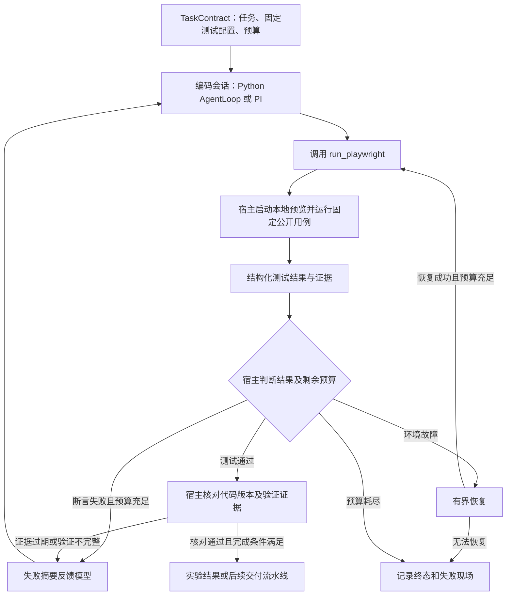

# CodingAgent 浏览器测试反馈方案

版本：v1.0

日期：2026-10-07

状态：Python 第一版已实现，已通过真实模型与 Chromium 的 Counter 闭环验证。PI 工具适配保留为后续工作。

## 目标与范围

把 Playwright 封装为模型可调用的 `run_playwright` 工具。编码会话调用工具后，由宿主运行固定的公开测试并返回结构化结果；断言失败且预算充足时，模型在同一会话中修改代码并再次验证。测试通过后，宿主核对最新代码与证据，决定是否结束编码并进入实验记录或后续交付流水线。

本方案沿用现有 Python 异步 AgentLoop、ToolExecutor、PolicyEngine、CompletionGate、事件日志与上下文管理。第一版采用同步等待、异步 I/O 的工具执行方式，不引入独立修复 Agent、通用浏览器操作工具或新的任务调度器。

用户流程图中的“PI 编码会话”在当前项目中对应 Python AgentLoop。外部 benchmark runner 已有 PI 后端分支；PI 可通过适配器使用相同宿主执行与结果协议，但 PI 工具注册属于后续接入，不能仅修改 Python 注册表就视为 PI 已支持。

## 当前实现与接入依据

当前 [AgentLoop](../src/aicoding_agent/agent/loop.py) 会把 ToolResult 的 output、data 和策略结果写入工具消息，下一轮模型调用能够读取。新增工具可以直接利用该消息通道反馈测试问题。

当前 [ToolContext](../src/aicoding_agent/tools/base.py) 和 [ToolExecutor](../src/aicoding_agent/tools/executor.py) 记录操作序号、最后修改序号、验证尝试及验证成功信息。[CompletionGate](../src/aicoding_agent/agent/gate.py) 要求代码修改之后重新完成合同规定的验证，但目前只检查 verification_commands，需要扩展到浏览器验证。

现有 [PlaywrightBrowserVerifier](../src/aicoding_agent/adapters/playwright.py) 从 DeploymentReceipt 读取 URL，主要检查页面加载、指定元素文本、控制台错误和失败请求。它继续服务于部署后的页面冒烟验证。新增编码侧工具执行完整 Playwright Test 套件，包括点击、输入与业务断言，不直接套用部署回执。

当前规模实验通过外部 runner 在编码结束后运行官方测试。加入公开测试反馈后，正式隐藏评分仍由外部 runner 在最终提交后执行。

## 执行流程



1. 宿主加载任务合同，解析并冻结允许执行的浏览器测试配置，完成依赖检查。
2. 编码会话读取需求、公开验证说明与工作区文件，修改代码。
3. 模型调用 run_playwright，参数仅为合同中的 verification_id。
4. 宿主清除该验证 ID 的旧成功记录，取得工作区版本、测试指纹与剩余预算，启动本地预览并执行测试。
5. 宿主保存完整证据，并将有界的测试摘要反馈模型。
6. 断言失败时，模型继续定位与修改；环境故障先由宿主进行有限恢复；所有执行消耗同一任务预算。
7. 测试通过后，模型调用 submit_result。CompletionGate 核对全部必需验证、代码版本、Plan 和 Task Graph。
8. 宿主确认完成后输出 AgentResult。实验模式执行独立评分；交付模式进入现有 DeliveryWorkflow。

测试通过本身不直接设置 Agent 为 completed，也不跳过 submit_result。模型在通过之后继续修改代码时，需要重新验证。

## 任务合同与工具接口

在 [TaskContract](../src/aicoding_agent/domain/models.py) 增加可选的 browser_verifications，默认空列表。每项配置包含以下字段；最终实现使用 Pydantic 模型校验。

| 字段 | 含义 |
| --- | --- |
| id | 唯一验证 ID，与 verification_commands 的 ID 不允许重复 |
| required | 是否作为完成门禁的必需验证，默认 true |
| suite_ref | 宿主侧预注册套件标识，解析到固定测试文件、配置和运行入口 |
| timeout_seconds | 单次执行上限，同时受任务剩余时间限制 |
| max_runs | 本任务允许的实际浏览器执行次数，包括环境重试 |
| max_failures_returned | 返回模型的失败数量上限 |

suite_ref 对应的宿主配置包含固定命令、执行目录、测试清单与指纹、预览启动方式、目标地址、允许网络范围和证据目录。模型只能选择合同已授权的 ID，不能在调用参数中指定 Shell、任意 URL、测试路径或替换断言。

配置示例仅表达新增字段，实际任务还需要现有的任务 ID、目标和验收标准：

```json
{
  "allowed_tools": [
    "read_file", "list_files", "search_text",
    "apply_text_patch", "create_file", "run_playwright", "submit_result"
  ],
  "browser_verifications": [
    {
      "id": "frontend-e2e",
      "required": true,
      "suite_ref": "counter-public",
      "timeout_seconds": 120,
      "max_runs": 6,
      "max_failures_returned": 10
    }
  ]
}
```

模型调用：

```json
{"verification_id": "frontend-e2e"}
```

RunPlaywrightTool 的风险分类为 ToolRisk.PROCESS，concurrency_safe=false。PolicyEngine 校验 allowed_tools、验证 ID、冻结套件、工作区范围与执行权限。没有浏览器配置的旧合同不向模型暴露该工具；显式允许工具但配置缺失时返回明确错误。

第一版仅执行公开测试。固定用例和配置由宿主保存，模型只读公开说明；模型生成的探索性测试如后续支持，需要另行标记，不能自行替换完成门禁所需的固定套件。

## 结果与模型反馈

BrowserTestResult 采用明确状态：passed、failed、infra_error、timeout。包含验证 ID、attempt_id、代码与套件指纹、执行时间、退出码、实际执行数量、通过数量、失败数量、跳过数量、失败摘要及 evidence_refs。

```json
{
  "verification_id": "frontend-e2e",
  "attempt_id": "browser-attempt-1",
  "status": "failed",
  "executed": 8,
  "passed": 7,
  "failed": 1,
  "skipped": 0,
  "failures": [
    {
      "test": "计数器不能减到负数",
      "step": "点击减号",
      "expected": "0",
      "actual": "-1",
      "message": "输入框值不符合预期"
    }
  ],
  "console_errors": [],
  "failed_requests": [],
  "evidence_refs": ["browser/browser-attempt-1/report.json"]
}
```

expected、actual、step 等信息只有在报告明确提供时才返回，解析器不推测缺失内容。错误堆栈和代码片段只取公开测试相关部分，限制长度并脱敏。页面文本、日志和错误信息作为数据回传，不能作为修改工具权限的指令。

正常运行发现断言失败时，ToolResult.ok=true，data.status=failed；表示工具正常完成，但代码尚未通过测试。权限拒绝或工具自身无法执行时，使用现有 ok=false 边界。环境故障在结构化结果中单独分类，不能仅依据非零退出码认定为代码错误。

模型可以使用失败名称、实际行为与相关日志定位修改位置。工具不直接修改代码、不要求模型照搬推测性修复建议。完整 JSON 报告保存在宿主，消息中只返回受限摘要，兼容现有 Evidence 归档与上下文压缩。

## 宿主执行与资源管理

新增 BrowserTestRunner 使用 Python async 接口管理子进程、报告读取和持久化；已有 JS/TS Playwright Test 继续通过 Node 执行，无须改写为 Python 测试。

预览服务由宿主启动并确认就绪。每次验证采用新建或显式失效的预览服务，确保页面使用本次代码；端口按工作区分配，不默认复用未知服务，不根据端口占用终止其他任务进程。执行结束、超时、取消或 Steering 中断时，清理本次拥有的测试与预览进程树。

测试、浏览器和前端服务不继承模型 API Key 或部署凭据。初版限制为受控本地测试目标，宿主同时约束页面重定向及子资源访问；仅检查入口 URL 不等于网络隔离。需要服务端网络访问的套件必须在宿主配置中明确声明，缺乏必要隔离能力时不自动扩大访问范围。

同一工作区内浏览器验证与写文件互斥。跨进程场景依赖工作区级锁或固定快照；既有逐文件锁不能单独保证整个测试期间代码稳定。测试开始和结束均核对输入指纹，发现变化则证据失效。

缓存、浏览器和证据优先使用项目现有 D 盘位置，报告默认保存在运行时根目录的 browser/<attempt_id> 下。默认关闭视频，保留结构化报告；失败时保留截图和 Trace，并限制证据大小。首版不加入成功结果缓存或后台测试，减少过期证据和取消清理的复杂度。

Pydantic 校验不仅限制字段，也校验 ID 唯一性、预算范围和路径。异步报告读取应放到 asyncio.to_thread 或异步文件接口，避免阻塞 AgentLoop。

## 完成门禁与证据有效性

浏览器执行前调用 begin_verification 清除旧成功结果。每次验证绑定 run_id、verification_id、attempt_id、开始操作序号、工作区输入指纹和套件指纹。输入指纹覆盖测试实际使用的源码、资源、构建输入和配置，并排除运行日志等生成文件。

仅在以下条件全部满足时记录成功证据：

- 进程正常结束，报告可解析且属于本次 attempt，退出码与结果一致。
- 固定套件预期的必需测试均已执行并通过，没有缺失、only 过滤或跳过必需测试。
- 实际执行数量大于零；报告中的部分通过不能替代整个必需套件通过。
- 测试及配置指纹与冻结值一致。
- 开始、结束及提交时的工作区输入指纹一致；验证后没有新增代码修改。
- 必需的验证报告存在，证据读取失败不按通过处理。

CompletionGate 将必需 verification_commands 与 required=true 的 browser_verifications 合并检查。旧 verification_commands 行为继续保留；仅配置必需浏览器验证的任务也可完成。修改代码且没有任何必需验证的任务保持 submitted_unverified。

本次测试失败会撤销同一 ID 的旧成功记录。只读分析任务沿用现有规则；对于合同明确要求浏览器验收的任务，即使模型没有声明修改文件，也必须执行该验收，不能走只读豁免。

Goal Evaluator 获得宿主确认的浏览器验证摘要和引用，不自行将模型描述视为通过证据。确定性证据的权威性规则同时覆盖命令验证和浏览器验证。

## 预算与终态

浏览器执行次数、修复轮数和环境重试都属于同一次任务。模型 turns、tool_calls、max_elapsed_seconds 与现有预算累计，不通过重启编码会话重置。单次执行期限取套件超时与任务剩余时间的较小值，任务时间耗尽时终止其拥有的进程树。

测试断言失败返回模型继续修复，Playwright 自身测试重试默认关闭。环境故障最多进行一次明确的宿主恢复或重试，依然受 max_runs 和任务时间约束。相同代码反复产生相同失败时，宿主提醒模型调整方案；次数达到上限后结束，不无限循环。

工具结果状态与 AgentStatus 分开使用。预算耗尽映射为现有 budget_exhausted；不可恢复环境故障按现有 failed 终态携带结构化 reason 和证据，报告单列基础设施原因；无法执行已要求的浏览器验收不能宣称 completed。取消与等待用户沿用项目已有状态，首版不新增平行的一套 Agent 终态。

持久化记录用于审计和恢复诊断。恢复会话不得仅加载历史 passed 字段就认定证据有效；至少重新核对合同、代码、套件与证据文件。无法可靠核对时重新验证。工具执行中断的 attempt 标为未完成，不能记录为成功。

实现中使用宿主预算检查点保留原始截止时间、模型轮数、工具调用数、工作区和套件指纹。中断期间也计入任务的总时限；同一 run_id 不允许更换预算或冻结套件。恢复后的历史工具消息不恢复成功证据，必须重新执行验证。

## 实验评分与交付兼容性

公开反馈测试在 AgentLoop 内执行，允许修改后再次运行。最终独立官方 Verifier 在宿主侧执行，隐藏测试源码、断言和失败详情不回注编码会话。

单次 Agent 尝试可包含多轮公开测试修复，预算保持固定。下一轮冻结协议需要明确此口径，并报告公开验证通过率与独立官方 Pass@1。若把隐藏评分失败反馈给模型后再次尝试，应另列为反馈后通过率，不能混入原始 Pass@1。

保持 Web-Bench 当前需求、历史回归与累计验证；公开反馈也应覆盖已完成的公开需求，避免修复新功能破坏旧功能。ReactBench 中没有公开浏览器测试或不适合 UI 测试的任务继续使用现有验证方式，不为了统一形式强行添加 Playwright。

Python benchmark 后端需生成 browser_verifications 并提供宿主套件；当前外部 runner 直接执行官方测试的同步函数不搬入 Python AgentLoop，应通过异步服务接入。PI 后端另行注册工具和完成证据适配，统一结果结构。新增能力改变 SUT 指纹，下一轮新建实验 root 并重新校准。

编码侧验证不触发 SFTP、SSH、Git push 或 Teambition 写入。DeliveryWorkflow 在 Agent 完成之后继续执行已有构建、测试环境部署、部署后 Playwright、审批及回滚。公开本地测试通过不替代部署后的页面检查，生产发布仍需独立审批。

## 模块改动与开发顺序

| 模块 | 计划改动 |
| --- | --- |
| domain/models.py | 新增 BrowserVerificationContract，TaskContract 增加默认空配置 |
| adapters/browser_tests.py | 新增宿主测试接口、执行器、JSON 报告解析与进程生命周期管理 |
| tools/playwright.py | 新增 RunPlaywrightInput 和 RunPlaywrightTool |
| tools/policy.py、builtin.py | 增加 ID 与套件授权规则、工具注册及按配置曝光 |
| tools/base.py、executor.py | 注入执行服务，保存可信验证证据并与写操作协调 |
| agent/gate.py、loop.py、preflight.py | 浏览器完成门禁、Goal 证据与依赖能力说明 |
| cli.py、chat/session.py | 运行与对话模式注入服务，恢复时检查证据 |
| benchmark 外部适配器 | 配置公开测试，保留独立隐藏评分与后端选择 |

开发分四步执行：先实现合同和报告解析并完成单元测试，再实现执行器和工具及生命周期测试，然后集成 Python AgentLoop、CompletionGate 和会话恢复，最后用小型真实用例验证并接入实验适配器。PI 后端接入在 Python 闭环通过之后进行。

第一版不开发任意浏览器点击工具、后台通知、多浏览器并发、自动测试生成或复杂验证服务。这些能力不影响图中闭环成立，后续可独立扩展。

## 验收标准

单元测试覆盖工具参数和策略校验、套件指纹、报告解析、断言失败与环境故障分类，以及报告大小限制。零测试、必需测试跳过、损坏报告、旧 attempt 报告、退出码不一致和测试篡改都必须阻断完成。

执行器测试覆盖预览就绪、超时、取消、环境恢复上限和进程树清理；工作区修改发生在验证期间或通过之后时，旧证据必须失效。测试次数与耗时必须进入同一任务预算。

集成测试使用固定 Counter 公开用例：基线负数断言失败，工具反馈 expected=0 与实际负数；编码会话修改代码后复测通过；再修改代码时完成门禁拒绝旧证据；重测并提交后才能进入 completed。另覆盖仅浏览器验证合同、旧合同和无验证任务的兼容行为。

先运行模块隔离测试，再运行聚焦 AgentLoop 与交付工作流测试。完成集成后执行项目要求的 `uv run ruff check .` 与 `uv run pytest`。存量失败需明确归因，不以排除失败项的运行替代全量通过。

最后在独立 D 盘工作区执行一次真实模型闭环，保存模型、合同、源码指纹和完整事件。通过后才冻结实验 runner 并重新校准，不能将设计状态描述为能力已完成。

## 日志与指标

沿用 tool.started、tool.finished 等现有事件，补充 browser.verification_started、browser.verification_finished、browser.verification_invalidated 与 browser.environment_retried。持久化事件追加写入，包含 attempt_id、suite 指纹、输入指纹、结果、耗时与证据引用。

报告增加每个任务的浏览器执行次数、失败后修复次数、公开验证结果、独立评分结果与环境故障原因。继续记录模型与工具调用的 P50、P90、P95；浏览器验证有多次执行时另统计其耗时分位数与样本数，单次执行则只报告一次耗时，避免把一个样本解释成稳定的时延分布。

## 参考

- [项目架构](architecture.md)
- [规模实验方案](benchmark-round2-plan.md)
- [服务器部署实验](server-smoke-experiment-plan.md)
- [Playwright 本地服务配置](https://playwright.dev/docs/test-webserver)
- [Playwright Reporter 配置](https://playwright.dev/docs/api/class-testconfig#test-config-reporter)
- [Playwright Trace 配置](https://playwright.dev/docs/trace-viewer)

## 第一版交付与验证记录

入口 `run`、`chat`、`deliver-phase-one` 支持 `--browser-suites`，读取宿主拥有的套件 JSON。`run` 另支持 `--runtime-dir`。浏览器运行证据必须位于模型工作区之外；未指定 runtime 时，浏览器任务默认使用工作区同级的 `.aicoding-agent-runtime/<workspace-name>`。未配置浏览器验证的旧任务沿用原行为。

[Counter 示例及使用说明](../examples/browser_feedback/README.md) 包含故障页面、固定 Playwright 用例、任务合同和宿主套件配置。运行器使用已有 Node Playwright Test，不自动安装依赖或浏览器。

2026-10-07 使用当前 env.txt 中配置的模型 API 与真实 Chromium 完成验证：6 个模型轮次、8 次工具调用。第一轮 2 项浏览器测试中 1 项失败，耗时 12.555 秒；模型根据反馈修改 counter.js，第二轮 2 项通过，耗时 6.527 秒；宿主最终判定 completed。源码、事件和浏览器证据保存于 `D:/Cache/CodingAgent/browser-feedback-model-20261007/`，未进行部署或规模实验。

最终检查：`uv run ruff check .` 通过；启用已有 D 盘 Playwright 与 Chromium 的 `uv run pytest` 为 351 passed、1 skipped（Windows 上跳过 POSIX 专用进程组测试）。验证覆盖模型失败反馈、浏览器真实交互、最新代码门禁、报告篡改、进程清理、恢复预算和旧合同兼容性。

外部 `D:/Github/benchmark-runs/tools/scale_webbench_runner.py` 的 Python 分支已提供显式选择的接入方式：`CODING_AGENT_BROWSER_FEEDBACK` 指向宿主 JSON，字段为 `suites_config`（绝对路径）及 `tasks`（以完整 task_id 为键、浏览器验证合同列表为值）。仅匹配任务获得公开测试反馈，独立官方评分仍在最终提交后执行。PI 分支暂不支持该配置；下一轮正式实验必须重新冻结指纹和校准。
